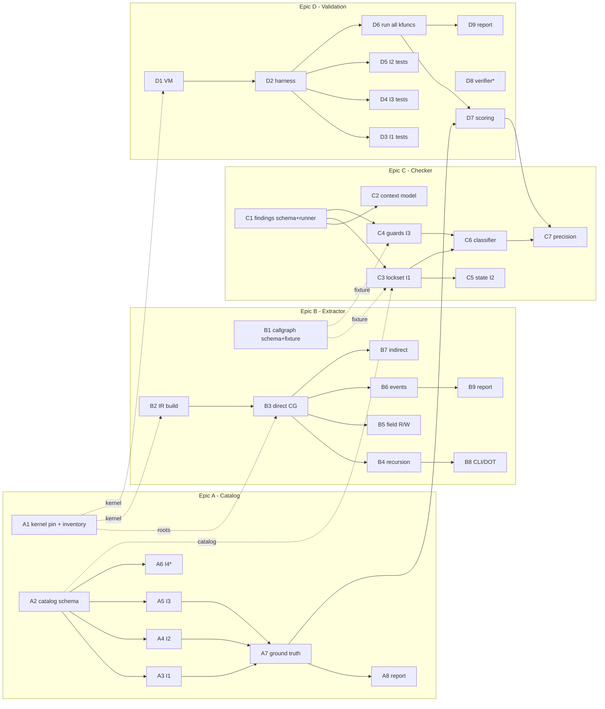

# Project plan

Four epics, one per person, each with a week-1 **contract** that unblocks the others. After M0, hard
dependencies only exist *inside* an epic, except for the final scoring step (C7 ← D7, A7 → D7).

## Milestones

| Milestone | When | Exit criteria |
|---|---|---|
| **Milestone 0** (M0, Contracts & setup) | week 1 | 3 schemas + fixtures merged, kernel pinned, IR builds, VM boots |
| **Milestone 1** (M1, Prototype) | weeks 2-4 | I1-I3 written up; extractor + checkers run end-to-end on 3-5 kfuncs; first test pairs |
| **Milestone 2** (M2, Full coverage) | weeks 5-8 | all kfuncs, recursive, all invariants checked, tests for every invariant |
| **Milestone 3** (M3, Validation & report) | weeks 9-10 | results table for all kfuncs, precision/recall, report |

## Work per person per milestone

| | A - Catalog | B - Extractor | C - Checker | D - Validation |
|---|---|---|---|---|
| **M0** | A1 pin kernel + inventory · A2 catalog schema | B1 call-graph schema + fixture · B2 clang IR build | C1 findings schema + runner on fixture | D1 test VM + baseline selftests |
| **M1** | A3 I1 · A4 I2 · A5 I3 | B3 direct call graph · B4 recursion · B5 field R/W sets | C2 context model · C3 lockset (I1) · C4 guards (I3) | D2 harness · D3 I1 tests · D4 I3 tests |
| **M2** | A6 I4 (stretch) · A7 ground truth | B6 ordered events · B7 indirect calls · B8 CLI/DOT | C5 ops_state/DSQ (I2) · C6 static-vs-runtime classifier | D5 I2 tests |
| **M3** | A8 report chapter | B9 report chapter | C7 precision pass | D6 run on all kfuncs · D7 scoring · D9 report · D8 verifier (stretch) |

## Dependency graph

Only hard dependencies are drawn. Dashed = soft (uses the fixture until the real thing lands).

## Working agreements

- **Branches/PRs:** `a/<task-id>-short-name`, one PR per task, reference the issue (`Closes #N`).
- **Contracts:** any change to `contracts/` needs approval from all consumers; bump the fixture in the same PR.
- **Weekly sync (30 min):** each epic demos against the shared fixtures; agree on contract changes.
- **Cross-epic pairing on invariants:** A owns the write-ups, but C (code) and D (tests) review each invariant PR
  - this keeps the 50% part from depending on one person.
- **Report:** one chapter per epic in `docs/report/0X-*.md`; D integrates.
